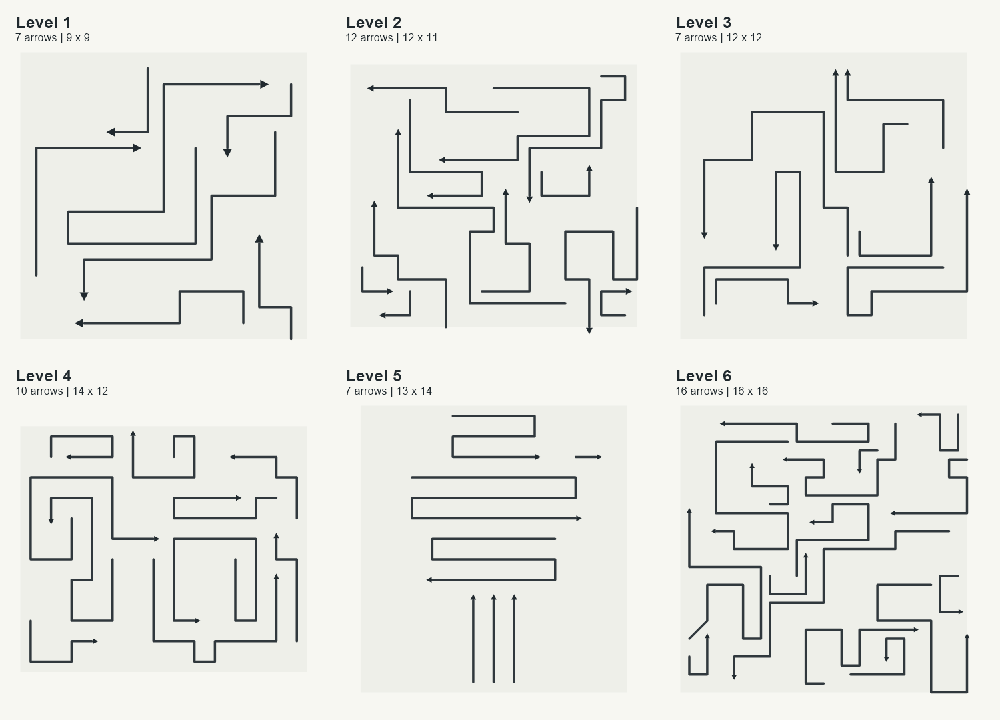

# Arrow Adventure — shared-board QA prototype

Arrow Adventure is a mobile-first puzzle game about clearing winding arrows from one tightly composed board. The arrowheads follow their own paths, the bodies trail behind, and the player must choose a safe exit order. This redesign contains six original, fixed QA boards. It keeps the approved logo and PWA assets while opening directly into the full-screen game.

The current feature branch is `redesign/shared-board-prototype`. Its deployments go to the independent [Arrow Adventure QA site](https://mirpkered.github.io/arrow-adventure-qa/); production at [arrow-adventure](https://mirpkered.github.io/arrow-adventure/) remains unchanged until an approved promotion.

## Geometry preview

The contact sheet below shows the six authored board layouts. It is a local geometry render for composition review, not a browser or physical-device screenshot.



## Play locally

Requires Node.js 22 or later and npm.

```sh
npm ci
npm run dev
```

The session starts at Level 1 and advances through the six boards. Restart restores the current board and its three hearts. Refreshing starts again at Level 1. This prototype does not read or write local storage, so stale saves from prior releases are ignored.

## Controls and rules

- Tap or click an arrow to try to clear it. Keyboard users can focus an arrow and press Enter or Space.
- The arrowhead follows its winding route; the body follows and retracts from the tail. After the route, the arrow continues in its final heading until its full body leaves the board.
- A blocked arrow loses one heart. Each board has three hearts. Restart after losing all hearts. There is no undo or timer.
- Body and arrowhead collisions are checked across the moving route. The solver and gameplay use the same deterministic simulator.
- The visible stroke presets are Thin 0.12, Medium 0.15 (default), and Bold 0.18 board cells. Collision width remains fixed at 0.18 cells, so a visual choice cannot change which moves are legal.
- In development and QA builds, hold the level label for two seconds to open QA settings. It includes animation speed, stroke presets, diagnostics, level navigation, restart, and settings reset. This panel and its dynamic code are excluded from production builds.

## Checks and builds

```sh
npm test
npm run typecheck
npm run build
```

To build locally with the QA Pages path and controls:

```sh
$env:VITE_BASE_PATH='/arrow-adventure-qa/'
$env:VITE_QA_MODE='true'
npm run build
```

The QA repository's manually dispatched GitHub Actions workflow validates a selected full source commit, runs tests and typecheck, builds with `/arrow-adventure-qa/`, and deploys only to the separate QA Pages repository. See [QA environment and release procedures](docs/QA_ENVIRONMENT.md). Do not use the production deployment for this branch.

## Architecture

- `src/game/catalog.ts` — six stable, frozen puzzle IDs and definitions, progression lookup, metadata and catalog checks.
- `src/game/geometry.ts` — fixed collision envelopes, segment and arrowhead geometry, nearest-path distance.
- `src/game/rules.ts` — path validation, full-body movement, deterministic collision simulation, solver and layout metrics.
- `src/game/session.ts` — hearts, restart state and in-memory level progression.
- `src/main.ts` — SVG board, delegated pointer hit-testing, requestAnimationFrame animation and game screen.
- `src/qa/qaPanel.ts` — QA-only long-press panel and diagnostics.
- `tests/game.test.ts` — frozen puzzle fingerprints, catalog checks, solver/gameplay agreement, geometry, input, hearts and non-persistence.

Detailed rules and authoring guidance: [Game Design](docs/GAME_DESIGN.md) and [Level Authoring](docs/LEVEL_AUTHORING.md).

## Current limitations

- The six boards are a QA sample and are not approved for production. Their puzzle definitions are fingerprinted to flag accidental edits.
- Browser mobile emulation and physical iPhone Safari testing were unavailable in this session. The preview is a local board render, not an interactive browser capture.
- Progress resets on a fresh visit; there is no level picker, persistent saving, tutorial, or Free Play mode.
- Black holes, switches, gates and portals are not implemented. No undo, timer or monetization is present.
